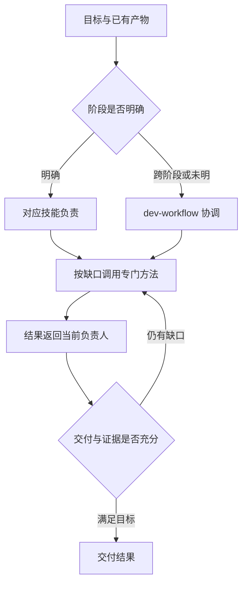

# 通过 `$dev-workflow` 分派工作

`$dev-workflow` 协调跨阶段任务。你给出目标和已有产物，它按真实缺口选择完整方法，把需要的步骤放入当前任务清单；阶段明确时也可以直接调用负责技能。本页介绍提示词怎样表达目标与边界。


## 提示词会经历什么



图中强调当前负责人和按需调用。调查、缺陷修复、功能实施、行为保持重构、性能问题和复杂任务定制执行都有各自方法。还有围绕指标持续优化、诊断运行时症状和已捕获轨迹、原型、视觉一致性、编写与评估技能、自主执行、开 PR、将 PR 或堆叠推进到可合并、落地已验证堆叠、自动推进 PR 队列或堆叠、协调项目级计划、会话接续、安全暂停、多阶段计划和工作树清理等流程。完整协作路由在 `dev-workflow`（操作流程目录）；保存交接、会话接续与明确暂停的完整方法由 `dev-handoff` 维护，也可直接调用。

## 说目标，不说仪式

不需要写一份规格。说明哪里出错、想要什么，再加上已经知道且能节省代理时间的信息：

```text
$dev-workflow 用户重试后收到两次通知。先复现，再修复并验证。
```

这是缺陷修复提示词。“先复现”是真实约束，不是客套话，流程会遵守。复杂修复会列出适用步骤；影响交付的省略说明原因，不为小任务填空清单。

如果目标是把同一症状写成可认领 Issue，使用 `$dev-issue`，并说明目标仓库及是否发布。更新已有 Issue 或追加评论也使用这个入口。Issue 中提到缺陷不等于要求立即修复；后续实施按已有授权继续。

## 提示词里放什么

有用的提示词最多携带五项内容，每项都可以放进一句话：

- **目标。** 说明出了什么问题，或想要什么。
- **完成判据。** 必须能通过或失败。“做得更好”“做一个小时”都不是判据。
- **想看到的证据。** 真实命令输出、流程视频、存储值，或前后对比数字。
- **已知事实。** 症状、复现步骤、日志行或链接可以减少一次搜索。
- **真实约束。** “先复现”“暂时不改代码”“行为零变化”“继续前让我审查”都会改变代理行为。

下面一条提示词包含全部五项：

```text
$dev-workflow 昨天部署后，CSV 导出会丢掉最后一行。失败任务编号 4812。先复现，再修复。完成意味着 6 万行夹具每一行都导出。给我修改前后的行数。
```

有两项值得省略：

- **具体做法。** 说要实现什么，给代理寻找比你选定路线更好方法的空间。技能清单也是如此，下方常见问题会说明。
- **一开始就给原因猜想。** 说出猜想会将搜索范围限制在你指向的位置。先让代理复述问题，再分享直觉。

长讨论或模糊缺陷这类杂乱报告，应先要求复述：

```text
$dev-workflow 阅读这段讨论。用自己的话和通俗语言复述根本问题。暂时不改任何代码。
```

误读会在复述时、代码出现之前显露。在这里纠正只花一条消息，不是一次错误修复。只想复述而不走操作流程时，运行 [`$dev-intake`](capabilities.md)。它说明代理理解的目标及你想解决的问题。文档已经明确、需要亲自操作确认页面和流程时，使用 `$dev-prototype`；它交付完整 HTML 和绑定具体版本的确认记录，文字复述不能代替这一步。

不确定提示词方向是否正确时，在发送前运行 [`$dev-sharpen`](capabilities.md)：

```text
$dev-sharpen 为 v2 配置格式写一份迁移指南。
```

代理会说明顶尖专业人士还会做哪些你没要求的工作、会从哪些最原始材料开始、采用什么方法和工具，以及什么外部证据能证明结果正确。随后将提示词改写成明确要求这些内容的版本，更深入而不扩大范围，同时保留你的选择。本次仅要求改写时，它交付提示词。用户已同时要求实施时，由当前执行负责人沿既有授权继续，不要求重新发送同一请求。

## 简短跟进

对话已经包含背景时，提示词可以缩短到几乎没有额外内容。以下都足够：

```text
$dev-workflow 做吧
```

```text
继续
```

```text
一直做完
```

简短也有效，因为当前对话已有目标，操作流程保存必要结构。[配置指南](guide-setup.md)说明如何核对技能加载与持续使用能力；不假定每个宿主都有持续模式。

## 用“new task”切换任务

长对话会积累上个任务的背景，切换主题时应明确说明：

```text
$dev-workflow new task。查清为什么退出登录后缓存条目还存在，暂时不改任何代码。
```

明确的新目标要求重新匹配，而不是沿用旧流程；“new task”只是这种意图的一种写法。“暂时不改代码”将本次限定为调查。状态追问或补充限制不取消原任务，不依赖固定关键词判断。

## 给并行工作独立机器

多个执行者操作同一仓库时，可能争用工作树、端口与构建输出。按[宿主能力适配](harness-adapter.md)选择真实提供的独立环境；远端工作机只有实际存在时才使用，不能假定某个云端命令可用。没有远端能力时，用独立 worktree、端口和输出目录隔离；无法隔离的资源串行处理。

工作必须留在本地时，提前要求 worktree：

```text
$dev-workflow new task。从 <基线> 新建分支和 worktree，再在那里移植解析器改动。
```

每个任务拥有独立分支和工作树可以隔离文件修改，端口、数据库与缓存仍需单独处理。需要隔离时调用 `dev-worktree`，明确基线和直接父分支。由用户已明确选择进入交付的子分支才合入父分支。

工作树会积累。磁盘紧张时可以问：

```text
$dev-workflow 什么在占用磁盘？清理那些有证据可以安全清理的 worktree。
```

`dev-worktree` 按合并证据、未提交工作和使用状态审计并清理工作树。在途 Git 冲突交 `dev-merge-conflict` 处理。

## 让工作继续运行

离开时说清完成条件、授权与预算，并核对是否有实际后台能力：

```text
$dev-workflow 我要离开一会儿。一直做，直到迁移检查显示旧调用者为零。记录你的决定。
```

这类任务由 `dev-workflow`（`$dev-workflow`）持续负责，已有流程适用就复用；否则使用`dev-workflow`（定制执行方法），按`dev-workflow`（决策证据方法）保存与复核记录。[睡觉时继续工作](guide-autonomous.md) 介绍完整的夜间执行约定。

**常见问题：** 通常无需预先枚举技能，例如“先 $dev-learn，再 $dev-architecture，再 $dev-parallel”。说明目标、已有结果与约束即可，负责人按真实缺口选择下一步。已有明确的方法或顺序要求时直接写出，技能协作沿用它，不把默认路线当成必经流程。

完整分派规则见 `dev-workflow`（`dev-workflow`） 本身。

下一页：[理解代码](guide-understanding.md)。
